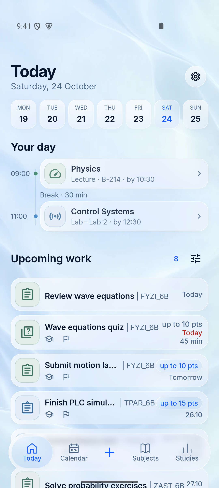
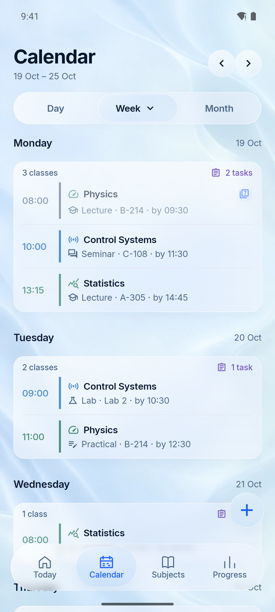
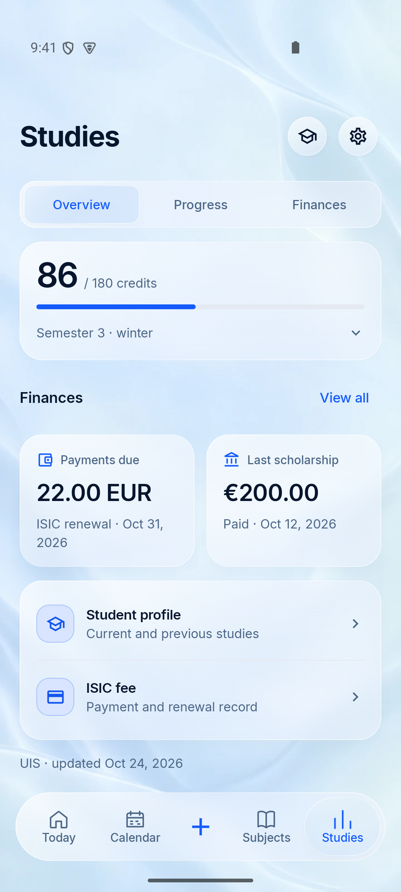
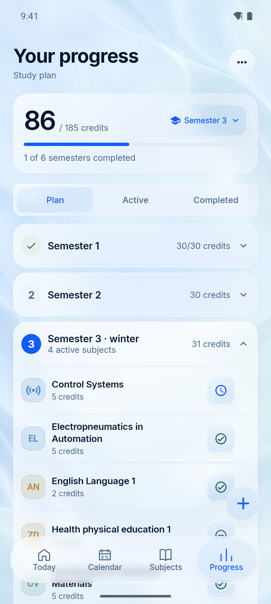
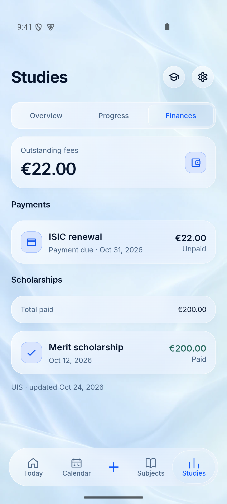
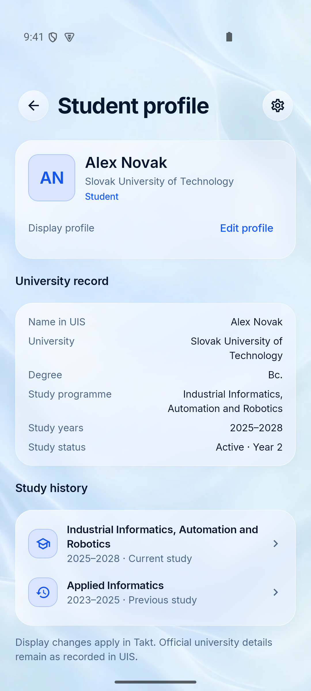
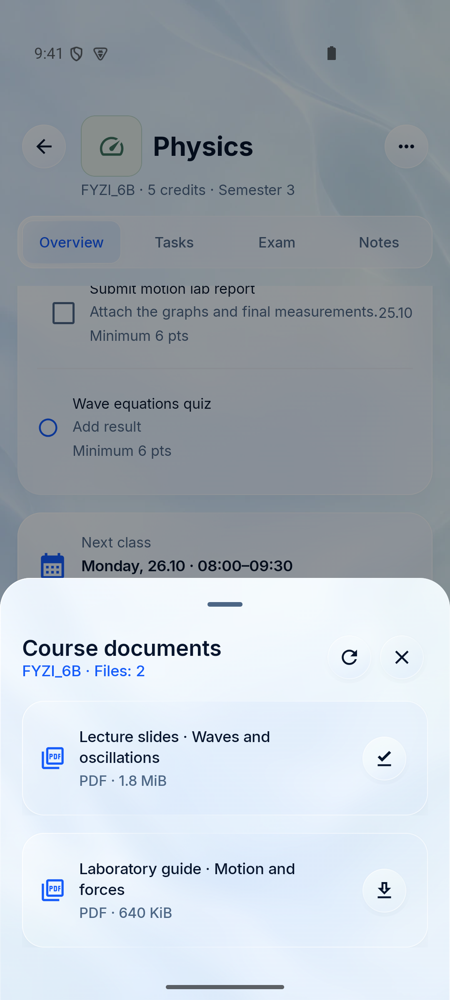
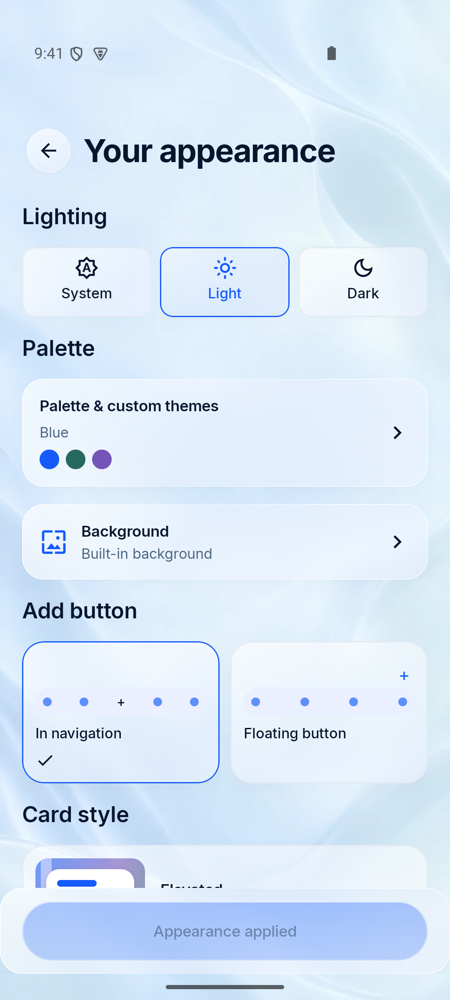
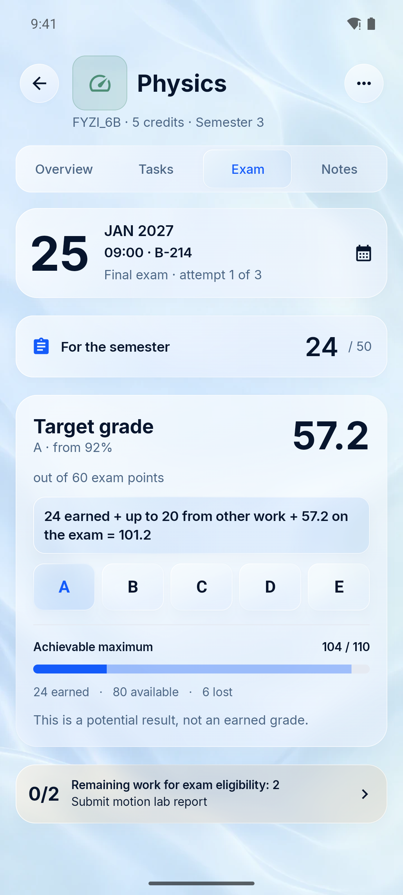
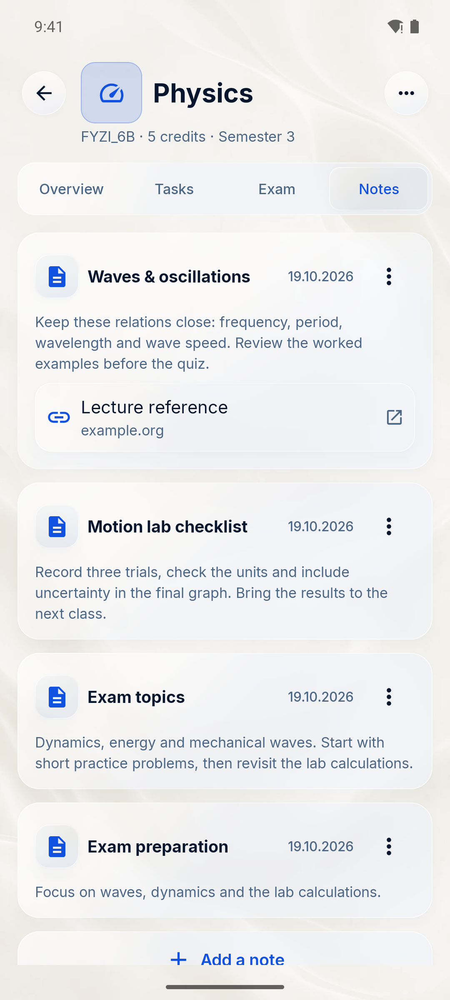

# Takt

Takt is an offline-first Android study planner for university schedules, grades, deadlines, and study progress.

Takt is built with Kotlin and Jetpack Compose. Version 0.4.0 is being prepared for release; the gallery below shows the current release candidate. Download the latest published build from Releases.

## Screenshots

Captured from the **0.4.0 development preview** on an Android 15 emulator, in English with fictional study data. A fresh installation starts with an empty study plan.

| Today | Weekly schedule |
| :---: | :---: |
| <br>Classes, deadlines and compact task requirements. | <br>Classes and work grouped by day. |
| Studies overview | Study progress |
| <br>Credits, university records and finances in one place. | <br>All semesters, course results and status filters. |
| University finances | Student profile |
| <br>Fees, ISIC renewal and scholarship history. | <br>Student identity and current or previous studies. |
| Course documents | Appearance |
| <br>Linked local files with clear download status. | <br>Themes, card styles and Add-button placement. |
| Exam preparation | Course notes |
| <br>Points, target grades and exam eligibility. | <br>Readable notes alongside your course materials. |

## What's new in 0.4.0

- **Studies** combines the student profile, progress, university fees, ISIC records and scholarship history. Switch between current and previous studies while keeping the current timetable separate.
- **Instant course documents:** saved links and local files appear together, with UIS metadata checked in the background. Current files open locally; an updated document gets a download icon and a named notification, and replaces the old file when downloaded.
- **More personal navigation:** choose the central Add button or an animated floating button, and pick course colors from a palette or return to Automatic.
- **Clearer work cards:** single-line titles and course codes, compact requirement icons with full explanations, and aligned points and dates.
- **More reliable UIS state:** automatic semester selection also works after restoring a backup; cached student records refresh in the background with retries.
- **More useful backups:** university records, course folder links and downloaded-file associations travel with the backup, and the restore preview shows study-related changes.

Downloaded document bytes remain in `Documents/Takt/<COURSE_CODE>` and are not embedded in the backup. Copy those files separately when moving devices and reconnect the folder in Takt.

## Install

Download the signed APK from [Releases](https://github.com/Kpyruy/Takt/releases/latest). Takt supports Android 8.0 and newer. Back up `Documents/Takt` before replacing a debug build: a release APK has a different signing key and cannot update a debug installation in place.

You can use Takt entirely offline. Optional STU UIS integration can import your study plan, subjects, progress, grades, academic periods, and timetable. Progress and subjects refresh on each app entry by default; refresh timing for each section can be changed in Settings. UIS sign-in is available from onboarding and Settings, with a verification-code step when UIS requires it. Your login and password are encrypted with a key held in Android Keystore, and Takt asks for your phone's biometric or screen lock when opening the connected app. Unlock state and UIS sessions stay in memory while the app is open, including short background transitions and file selection. They are cleared when the app is explicitly closed or its process ends; credentials and cookies are not included in `Documents/Takt` backups.

## Modules

- `app` — Android entry point and navigation shell
- `core:model` — Android-free domain models and calculations
- `core:database` — Room database, entities, and DAOs
- `core:data` — repositories and local data orchestration
- `core:ui` — shared Compose theme and reusable UI components
- `feature:home` — dashboard and today's timetable
- `feature:calendar` — timetable/calendar
- `feature:subjects` — subjects and grade tracking
- `feature:studyplan` — student profile, study history, credit progress and university finances
- `feature:settings` — app preferences, language, and backup controls

## Current target

Android, Kotlin, Jetpack Compose, Room, offline-first.

## Build locally

Use JDK 17, Android SDK platform 35 and build tools 35.0.0. Set `ANDROID_HOME` to your SDK directory, or put `sdk.dir=/absolute/path/to/Android/Sdk` in the ignored `local.properties` file.

```sh
./gradlew :app:assembleDebug
./gradlew :core:model:test :core:data:testDebugUnitTest :app:lintDebug
```

The wrapper pins Gradle 8.11.1 and verifies the distribution SHA-256. The Gradle wrapper and build configuration stay in Git so Android Studio can open the project; generated Gradle, Android Studio, and APK files are ignored. The debug APK is generated at `app/build/outputs/apk/debug/app-debug.apk`.

The interface supports Ukrainian, English, and Slovak. English is the default for new installs; choose another language during setup or in Settings. The choice is included in the `Documents/Takt` backup. To sign a release APK, use Android Studio's **Build → Generate Signed Bundle / APK → APK**, choose the **release** variant, and keep the keystore outside the repository. Use the same key for every update.

The opt-in `PulseFlowTest` writes review fixtures through the real repositories. Run it only on a disposable emulator (API 35 recommended), with `-e pulseReview true`; it is skipped without that flag.

## License

Takt's source code is [source-available](LICENSE), not open-source licensed. Reuse in another project requires prior written permission from Kpyruy, considered only for free projects with publicly available source code. Paid or commercial use is not permitted. Design screenshots and artwork are not granted for reuse. The bundled [Inter](core/ui/src/main/resources/META-INF/Inter-LICENSE.txt) font keeps its own license.
